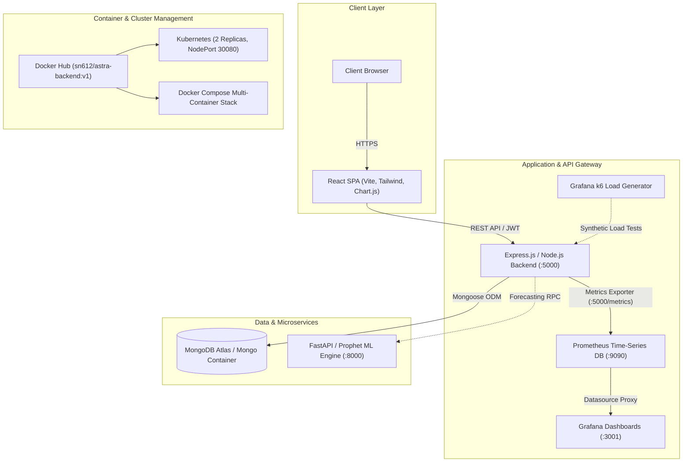
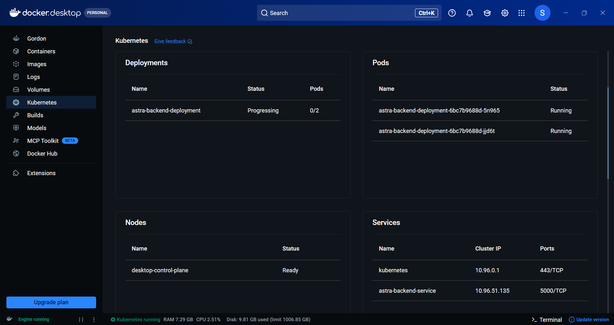

# ASTRA — Aadhaar Statistical Trends & Resource Analytics

[](https://astra-frontend-service.onrender.com)
[](https://hub.docker.com/r/sn612/astra-backend)
[](./k8s)
[](./monitoring)
[](./monitoring/load_test.js)

**ASTRA (Aadhaar Statistical Trends & Resource Analytics)** is an enterprise statistical decision-support platform designed for authorized personnel. It aggregates demographic, biometric, and resource-allocation datasets to support data-driven policy planning without exposing personally identifiable information (PII).

---

## 🌐 Live Production Deployments

The production stack is deployed across cloud services with automated containerization and cloud database management:

| Service | Cloud Platform | Public Endpoint / URL |
| :--- | :--- | :--- |
| **Frontend SPA** | Render (Static Site) | [https://astra-frontend-service.onrender.com](https://astra-frontend-service.onrender.com) |
| **Backend REST API** | Render (Web Service) | [https://astra-backend-service.onrender.com](https://astra-backend-service.onrender.com) |
| **API Healthcheck** | Render (Liveness Route) | [https://astra-backend-service.onrender.com/health](https://astra-backend-service.onrender.com/health) |
| **Metrics Endpoint** | Render (Prometheus) | [https://astra-backend-service.onrender.com/metrics](https://astra-backend-service.onrender.com/metrics) |
| **Database Cluster** | MongoDB Atlas (M0) | Hosted cloud replica set (Pre-seeded with live data) |

### Demo Administrator Credentials
- **Email:** `admin@astra.gov.in`
- **Password:** `Password123`

---

## 🏗️ Architecture & Technology Stack



- **Frontend:** React 18, Vite, Chart.js, Tailwind CSS.
- **Backend:** Node.js, Express, `prom-client` metrics instrumentation, Mongoose.
- **Database:** MongoDB Atlas (Cloud) / Local MongoDB Docker container.
- **Containerization:** Multi-stage Dockerfile pushed to Docker Hub (`sn612/astra-backend:v1`).
- **Orchestration:** Docker Compose (local bridge) & Kubernetes manifests (`k8s/deployment.yaml`, `k8s/service.yaml`).
- **Observability:** Prometheus (time-series scraping) + Grafana (auto-provisioned dashboard).
- **Performance & Stress Testing:** Grafana k6 automated load simulation.

---

## 🚀 Local Deployment with Docker Compose

To spin up the entire orchestrated stack (Backend, MongoDB, Prometheus, and Grafana) locally:

### 1. Prerequisites
- [Docker Desktop](https://www.docker.com/products/docker-desktop/) installed and running.

### 2. Boot the Entire Stack
```bash
docker compose up -d
```

### 3. Verify Local Services
Once launched, the following local services are active:
- **Backend API & Health:** [http://localhost:5000/health](http://localhost:5000/health)
- **Backend Prometheus Metrics:** [http://localhost:5000/metrics](http://localhost:5000/metrics)
- **Prometheus Dashboard:** [http://localhost:9090](http://localhost:9090)
- **Grafana Observability Portal:** [http://localhost:3001](http://localhost:3001) *(Login: `admin` / `admin`)*

---

## 📈 Observability & Load Testing (Grafana k6)

The project includes continuous observability and performance verification using **Prometheus** and **Grafana k6**.

### Run Simulated Traffic
Generate realistic user traffic to trigger Prometheus rate calculations and visualize live metric spikes:

```bash
docker run --rm -i --network devops-2026-cs-e-04_default -v "${PWD}/monitoring:/monitoring" -e TARGET_URL="http://backend:5000" grafana/k6 run /monitoring/load_test.js
```
*(Or if running `k6` binary directly on host: `k6 run -e TARGET_URL="http://localhost:5000" monitoring/load_test.js`)*

### Grafana Dashboard Metrics Plotted
- **CPU Usage (Process):** `rate(process_cpu_user_seconds_total[1m]) * 100`
- **Resident Memory:** `process_resident_memory_bytes / 1024 / 1024` (in MB)
- **HTTP Request Rate & Duration:** `rate(http_request_duration_ms_count[1m])` (Req/sec)

---

## ☸️ Kubernetes Deployment (M7)

Kubernetes manifests are located in the [`k8s/`](./k8s) directory and configure high availability with replica management:

1. **Deployment (`k8s/deployment.yaml`):**
   - 2 Pod Replicas pulling `sn612/astra-backend:v1` from Docker Hub.
   - Resource limits: `128Mi` RAM / `250m` CPU.
   - Liveness & Readiness probes targeted at `/health`.

2. **Service (`k8s/service.yaml`):**
   - NodePort Service mapping port `5000` to `30080`.

### Apply Manifests to Local Cluster:
```bash
kubectl apply -f k8s/deployment.yaml
kubectl apply -f k8s/service.yaml
```

### Inspect Pod Status:
```bash
kubectl get pods -l app=astra-backend
kubectl get services
```

---

## 📸 Deployment & Verification Evidence

### 1. Cloud Production Deployment (Render)


### 2. Kubernetes Cluster Pod Verification


### 3. Live Grafana Performance Dashboard (Post-k6 Load Test)


---

## 🔒 Security Architecture
- **Data Privacy:** ASTRA aggregates counts by region, period, and category without storing raw citizen Aadhaar rows.
- **Authentication:** JWT tokens with access restriction checks.
- **Security Audit Logs:** Suspicious or unauthorized actions are logged to the immutable `AuditLogs` collection.
